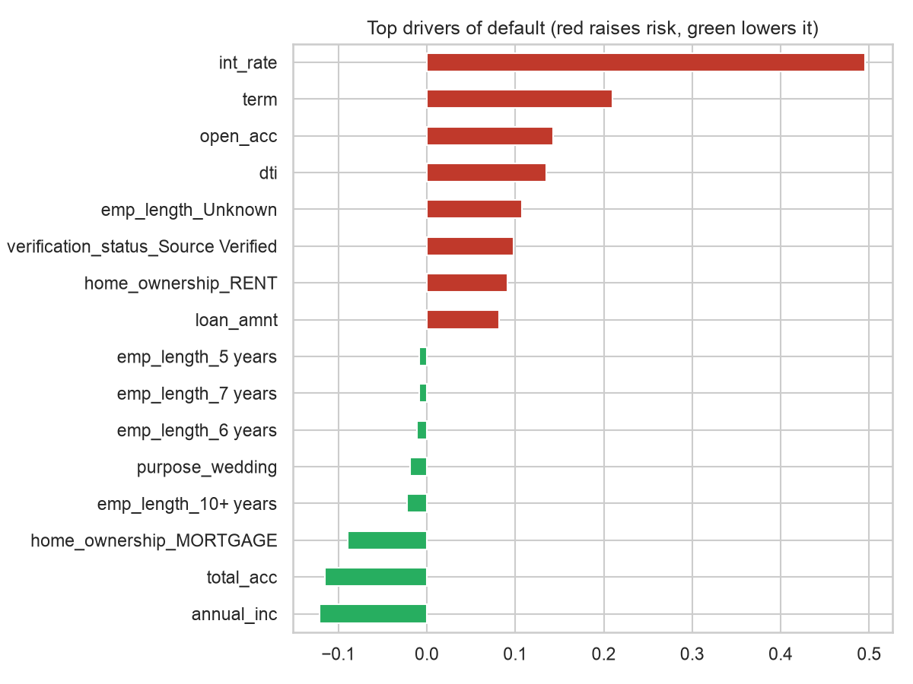
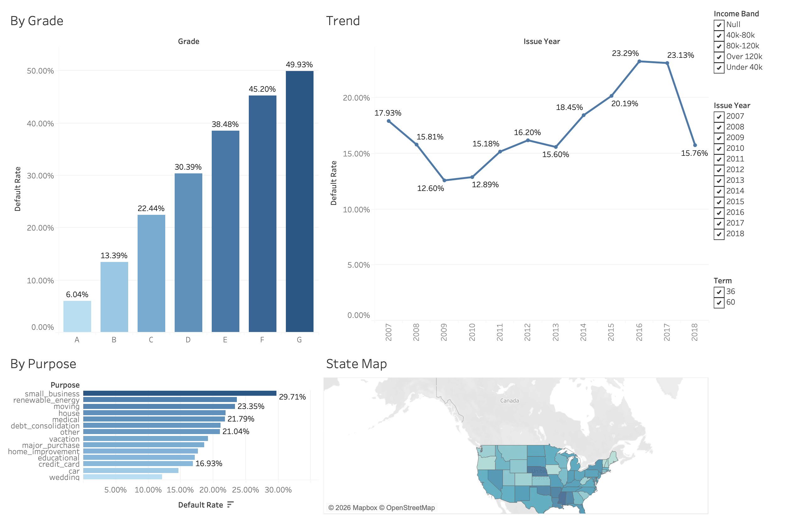
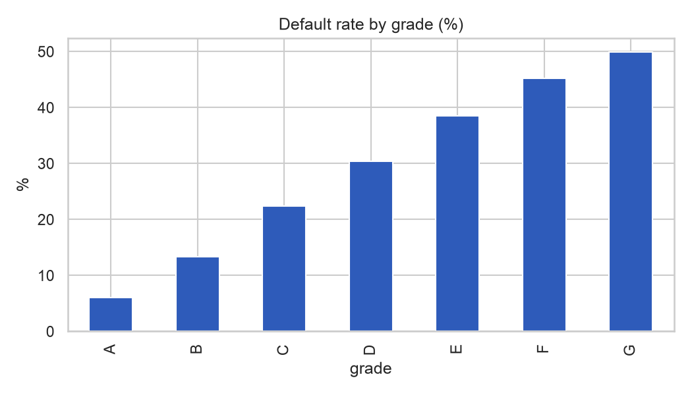
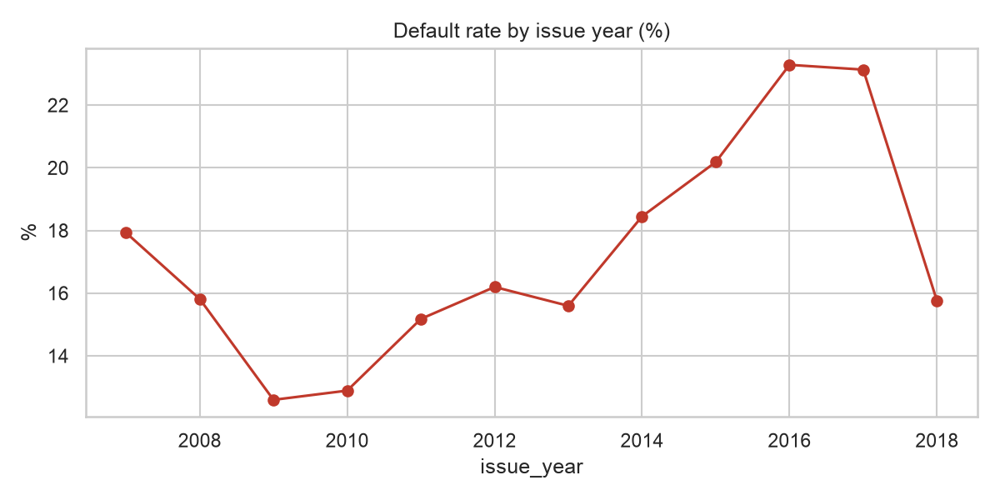
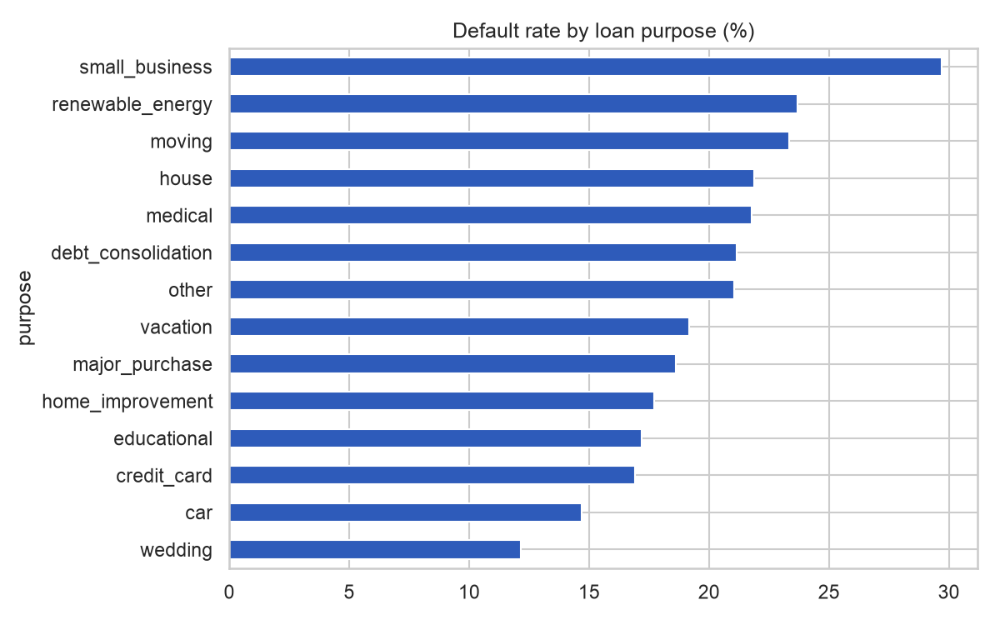

# Loan-Default-Risk-Analysis
SQL, Python and Tableau analysis of loan default risk drivers using Lending Club data
# Loan Default Risk Analysis

SQL, Python and Tableau analysis of 1.3M Lending Club loans to find which borrower segments drive defaults.

## Business question
Which borrower segments default most, and what drives it?

## Tools
MySQL (CTEs, window functions) · Python (Pandas, scikit-learn, Matplotlib, Seaborn) · Tableau

## Approach
1. Kept loans with a final outcome (Fully Paid, Charged Off, Default): 1,345,350 loans, 20.0% default rate
2. Loaded the data into MySQL and wrote analysis queries (`sql/analysis_queries.sql`)
3. Cleaned the data, explored patterns and trained a logistic regression model (`notebooks/02_analysis.ipynb`)
4. Built an interactive Tableau dashboard with grade, year, purpose and state views

## Key insights
1. **Risky grades drive losses.** Grades D-G are 25% of loans but 43.2% of defaults. Grades A-B are 46.7% of loans but only 24.9% of defaults.
2. **Default risk climbs steeply with grade.** The default rate rises from 6.0% (grade A) to 49.9% (grade G).
3. **60-month loans default twice as often.** 32.4% default rate versus 16.0% for 36-month loans.
4. **Small business loans are the riskiest purpose**, at 29.7% against a 20.0% overall rate.
5. **Defaults peaked for 2016-2017 loans** at about 23%, versus a low of 12.6% in 2009. The 2018 drop is likely a data effect, since recent loans are only counted once they have a final outcome.
6. **Total defaulted amount is about $4.18B** across the dataset.

## Recommendations
- Reprice or tighten approval for grades E-G and long-term (60-month) loans.
- Review underwriting for small business loans.
- Monitor segments by origination year, since risk shifts over time.

## Model
Logistic regression (class-balanced, 80/20 split): ROC-AUC **0.705**, default recall 0.62, default precision 0.32, accuracy 0.66.
Interest rate, loan term, open accounts and debt-to-income ratio raise risk most. Higher income, more total accounts and a mortgage lower it.
This is a baseline model. Next steps would be gradient boosting and tuning the decision threshold.

## Dashboard

[Watch a short walkthrough](https://drive.google.com/file/d/1oeR9ryKkL0ctwM1O8pad3gGpUr3TVv2G/view?usp=sharing)

## Run it yourself
The data is not included because of its size. Download `accepted_2007_to_2018Q4.csv.gz` from Kaggle ("All Lending Club loan data") into `data/`, then run the notebooks in order.